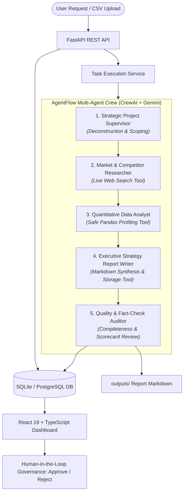

# AgentFlow AI: Autonomous Multi-Agent Business Automation Platform

[](https://www.python.org/)
[](https://crewai.com)
[](https://aistudio.google.com/)
[](https://fastapi.tiangolo.com)
[](https://vitejs.dev/)
[](LICENSE)

AgentFlow AI is a production-grade multi-agent autonomous platform designed for market research, quantitative business data analysis, executive report generation, and human-in-the-loop decision governance.

Powered by **CrewAI** and **Google Gemini**, AgentFlow AI replaces weeks of manual consulting research with an orchestrated team of specialized AI agents that gather real web evidence, profile client CSV datasets deterministically, draft boardroom-ready reports, and audit deliverables for factual integrity.

---

## Architecture Overview



---

## Agent Responsibilities

| Agent Role | Responsibility | Tools & Capabilities |
| :--- | :--- | :--- |
| **Strategic Supervisor** | Understands user requests, sets task objectives, and orchestrates sequential workflow without token bloat. | Task scoping & context routing |
| **Market Researcher** | Gathers authentic market intelligence, competitor profiles, consumer trends, and tailwinds. | `web_search_tool` (real DDGS search, anti-injection sanitation) |
| **Quantitative Data Analyst** | Profiles user CSV datasets, computes statistical aggregates, and flags data anomalies. | `analyze_csv_data_tool` (Deterministic Pandas, zero arbitrary code execution) |
| **Report Writer** | Synthesizes qualitative research and quantitative findings into an executive report with a 30-day marketing plan. | `save_markdown_report_tool` (Path traversal protected disk persistence) |
| **Quality Reviewer** | Scrutinizes report completeness, checks factual consistency, verifies citations, and produces an audit verdict. | Quality Scorecard & Revision Feedback |

---

## Real Tool Integrations & Security

1. **Anti-Prompt-Injection Web Search (`web_search_tool`)**:
   - Executes live searches via `ddgs`.
   - Never hallucinates URLs or fabricates sources.
   - Treats all retrieved text as untrusted content with prompt isolation fences to defend against adversarial prompt injection.

2. **Safe Deterministic Data Profiling (`analyze_csv_data_tool`)**:
   - Analyzes datasets up to 100,000 rows with Pandas.
   - Computes descriptive statistics (mean, median, std, min, max), missing value percentages, and categorical distributions.
   - **Zero Code Execution**: Rejects LLM-generated Python scripts, eliminating remote code execution (RCE) vectors.

3. **Secure File Storage (`save_markdown_report_tool`)**:
   - Writes generated deliverables to the `outputs/` directory.
   - Validates filenames and paths using absolute prefix checking to prevent path traversal attacks (`../`).

4. **Human-in-the-Loop Governance**:
   - Enforces human sign-off (`APPROVED` / `REJECTED`) with audit comments before any external actions (e.g., publishing marketing copy, sending client deliverables, or launching ad spend).

---

## Technology Stack

- **Backend Framework**: Python 3.13, FastAPI, Uvicorn, Pydantic V2
- **Agent Framework**: CrewAI 1.15.27, CrewAI Tools
- **LLM Engine**: Google Gemini API (`gemini/gemini-3.5-flash`) via `google-genai`
- **Data & Tools**: Pandas 2.2, SQLAlchemy 2.1, Tabulate, DDGS 9.16
- **Database**: SQLite (built with SQLAlchemy for seamless PostgreSQL migration)
- **Frontend Dashboard**: React 19, TypeScript, Vite, Lucide Icons, Vanilla CSS Design System
- **Testing & Quality**: Pytest 9.1, Pytest-Asyncio, Automated Benchmark Evaluation Suite

---

## Windows Setup & Execution Guide

### 1. Prerequisites
- Windows 10/11
- Python 3.13 (or 3.11+)
- Node.js (v20+ or v26+)

### 2. Activate Virtual Environment
Open PowerShell in the project root `C:\Users\AKASH\agentflow-ai`:
```powershell
.\.venv\Scripts\Activate.ps1
```

### 3. Environment Configuration
Verify your `.env` file exists at the project root:
```env
GEMINI_API_KEY=your_gemini_api_key_here
GEMINI_MODEL=gemini/gemini-3.5-flash
```

### 4. Run Automated Tests
Execute the unit and integration test suite:
```powershell
$env:PYTHONPATH="."
python -m pytest backend/tests -v
```

### 5. Run the Evaluation Suite
Measure data profiling accuracy, live search citation grounding, and security controls:
```powershell
$env:PYTHONPATH="."
python backend/evaluations/eval_runner.py
```

### 6. Start the FastAPI Backend
Launch the backend server on port 8000:
```powershell
$env:PYTHONPATH="."
uvicorn backend.app.main:app --host 127.0.0.1 --port 8000 --reload
```
Open your browser to:
- Interactive Swagger UI: [http://127.0.0.1:8000/docs](http://127.0.0.1:8000/docs)
- Health Check: [http://127.0.0.1:8000/health](http://127.0.0.1:8000/health)

### 7. Start the React Frontend Dashboard
In a separate terminal window:
```powershell
cd frontend
npm.cmd run dev
```
Open your browser to [http://localhost:5173](http://localhost:5173).

---

## API Reference

| Method | Endpoint | Description |
| :--- | :--- | :--- |
| `GET` | `/health` | System health, Gemini model status, and database connection. |
| `POST` | `/api/tasks` | Submits a new business task with optional CSV file upload. |
| `GET` | `/api/tasks` | Returns paginated list of all historical and running tasks. |
| `GET` | `/api/tasks/{task_id}` | Retrieves detailed task state, agent timeline events, and report. |
| `GET` | `/api/tasks/{task_id}/report` | Streams the final executive report formatted in raw Markdown. |
| `POST` | `/api/tasks/{task_id}/approve` | Submits human approval decision (`approved: true/false`, notes). |

---

## Docker Deployment

To launch the entire platform in Docker:
```bash
docker-compose up --build
```
- Backend: `http://localhost:8000`
- Frontend: `http://localhost:5173`

---

## Interview & Freelance Presentation Guide

When showcasing AgentFlow AI to hiring managers or freelance clients:

1. **Highlight Real Business Impact**: Walk through the Indian Kidswear case study. Demonstrate how the platform identifies competitors, analyzes SKU data, and delivers a 30-day marketing plan in under 90 seconds.
2. **Emphasize Security & Governance**: Point out that CSV analysis runs deterministically without arbitrary LLM code execution, and reports require human sign-off before external release.
3. **Showcase Enterprise Modularity**: Show the clean separation between API routes, Pydantic schemas, CrewAI agents, and SQLAlchemy models.
